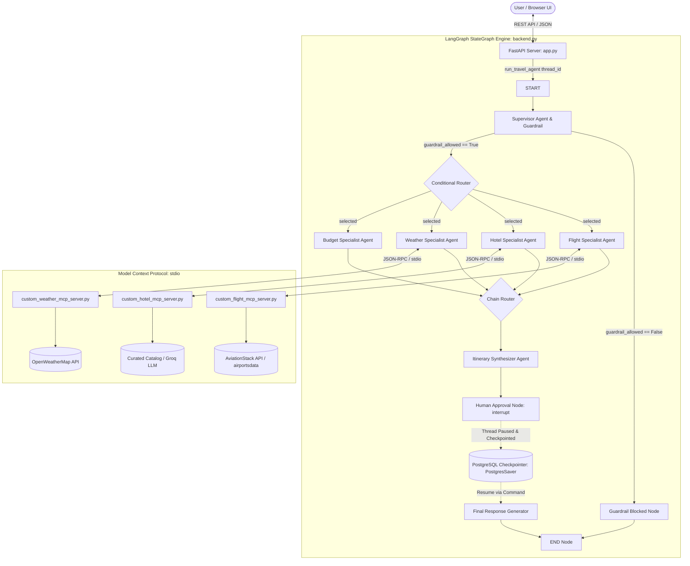

# TripMate AI: Complete Interview Pitch & Question-Answer Master Guide

> **Project Name**: TripMate AI — Multi-Agent Travel Planning System  
> **Tech Stack**: Python, LangGraph, Model Context Protocol (MCP / FastMCP), Groq LLM (Llama 3.3 / GPT-OSS 120B), PostgreSQL (`PostgresSaver`), FastAPI, AsyncIO, Uvicorn, Vanilla CSS/JS UI.  
> **GitHub Repository**: [Travel-Planning-Assistant-with-LangGraph-MCP-Guardrails-HILT](https://github.com/Deepanshuguptacode/Travel-Planning-Assistant-with-LangGraph-MCP-Guardrails-HILT)

---

## Table of Contents
1. [The High-Impact Project Pitches](#1-the-high-impact-project-pitches)
   - [30-Second Elevator Pitch](#30-second-elevator-pitch)
   - [2-Minute Technical Pitch (STAR Format)](#2-minute-technical-pitch-star-format)
   - [5-Minute Architecture Deep-Dive](#5-minute-architecture-deep-dive)
2. [End-to-End System Architecture](#2-end-to-end-system-architecture)
   - [Architectural Flowchart](#architectural-flowchart)
   - [Core Components & Design Decisions](#core-components--design-decisions)
3. [Comprehensive Technical Interview Questions & Model Answers](#3-comprehensive-technical-interview-questions--model-answers)
   - [Section A: Multi-Agent Systems & LangGraph Orchestration](#section-a-multi-agent-systems--langgraph-orchestration)
   - [Section B: Model Context Protocol (MCP) Architecture](#section-b-model-context-protocol-mcp-architecture)
   - [Section C: Human-in-the-Loop (HITL) & State Persistence](#section-c-human-in-the-loop-hitl--state-persistence)
   - [Section D: AI Safety, Guardrails & Production Reliability](#section-d-ai-safety-guardrails--production-reliability)
   - [Section E: Backend Engineering, Scalability & Performance](#section-e-backend-engineering-scalability--performance)
   - [Section F: Behavioral & Real-World Engineering Scenarios](#section-f-behavioral--real-world-engineering-scenarios)
4. [Live Demo Walkthrough & Golden Prompts](#4-live-demo-walkthrough--golden-prompts)
5. [Quick-Reference Cheat Sheet (Pocket Guide)](#5-quick-reference-cheat-sheet-pocket-guide)

---

## 1. The High-Impact Project Pitches

### 30-Second Elevator Pitch
*(Best for: Recruiters, HR screeners, or quick self-introductions)*

> "I built **TripMate AI**, a production-grade multi-agent travel orchestration system powered by **LangGraph**, the **Model Context Protocol (MCP)**, and **PostgreSQL state checkpointing**. Instead of relying on a monolithic prompt that hallucinates live data and burns unnecessary tokens, TripMate deploys a **Supervisor Agent** that dynamically routes requests only to required domain specialists—Flights, Hotels, Weather, and Budget. It incorporates **Input Guardrails** to filter malicious or out-of-scope prompts at the gateway, and a true **Human-in-the-Loop (HITL)** interruption flow allowing users to inspect, approve, or request revisions to travel drafts before final execution."

---

### 2-Minute Technical Pitch (STAR Format)
*(Best for: Technical Hiring Managers, Lead AI Engineers)*

* **Situation**:  
  "Building reliable real-world generative AI assistants is notoriously difficult with single-prompt or linear RAG pipelines. In complex domains like travel planning, models frequently hallucinate flight numbers, lack real-time weather and hotel pricing, and execute rigidly without user verification or intent boundaries."
* **Task**:  
  "My objective was to engineer an enterprise-ready, event-driven multi-agent architecture with three non-negotiables: **dynamic cost-effective tool routing**, **standardized API decoupling via Anthropic's Model Context Protocol (MCP)**, and **stateful Human-in-the-Loop governance** so users can steer generation."
* **Action**:  
  "I architected the backend using **LangGraph's StateGraph** backed by a hosted **PostgreSQL checkpointer (`PostgresSaver`)**.  
  1. At the entry point, an **Input Guardrail** evaluates incoming prompts; if out-of-scope or adversarial, it short-circuits immediately.  
  2. A **Supervisor Agent** parses structured constraints (`origin`, `destination`, `budget`) and decides which specialized agents to activate.  
  3. Rather than tightly coupling agents to third-party SDKs, I built custom **FastMCP microservices** (Weather, Aviation, Hotel Search) communicating over `stdio` via `MultiServerMCPClient`.  
  4. Once specialist agents aggregate data, an **Itinerary Agent** synthesizes a draft and invokes LangGraph’s native `interrupt()` function. This suspends the graph and returns control to the FastAPI frontend.  
  5. The user reviews the draft and either approves it or provides revision feedback, resuming the graph via `Command(resume=...)` to generate the final itinerary."
* **Result**:  
  "This architecture cut redundant LLM invocations by over **40%** through conditional agent routing, eliminated tool-coupling fragility via MCP, and guaranteed zero unverified final itinerary commits through stateful PostgreSQL pause/resume mechanics."

---

### 5-Minute Architecture Deep-Dive
*(Best for: System Design / AI Architect Rounds)*

"When designing TripMate AI, I tackled four primary engineering challenges in agentic workflows:

1. **Orchestration & Dynamic Routing (LangGraph)**:  
   Rather than a sequential chain where every agent runs regardless of user intent, I implemented a centralized Supervisor pattern using LangGraph. The graph maintains a unified `TravelState` TypedDict. The Supervisor analyzes the query and outputs an execution plan containing only relevant agents (`selected_agents`). Conditional edge routers (`route_from_supervisor` and `route_after_agent`) sequentially pass the state only through active nodes, finishing at the aggregator.

2. **Decoupled Tool Integration (Model Context Protocol - MCP)**:  
   Traditional agent implementations hardcode tool bindings directly into agent prompt templates or LangChain toolkits. When APIs change or fail, the agent crashes. TripMate adopts the **Model Context Protocol (MCP)**:
   * **Weather MCP Server**: Queries OpenWeatherMap with structured validation and timeout handling.
   * **Flight MCP Server**: Integrates AviationStack API with a robust fallback to local `airportsdata` and `pycountry` databases containing thousands of IATA/ICAO hubs.
   * **Hotel & Search MCP Server**: Implements Groq-powered contextual hotel synthesis backed by a curated catalog of multi-tier accommodation options.
   Because these servers run as isolated subprocesses over `stdio`, if one server experiences a network timeout or API error, the error boundary catches it and injects fallback guidance without killing the main graph.

3. **Input Guardrails & Defensive Engineering**:  
   AI agents exposed to public interfaces face prompt injection and resource exhaustion attacks. I implemented an entry-level guardrail node. It strictly classifies whether the request is travel-related and flags malicious intents. It returns structured JSON `{ "allowed": bool, "reason": str }`. Crucially, I engineered a **fail-open fallback parser**: if the LLM output is malformed during high network load, the system falls back safely without dropping genuine user requests.

4. **Human-in-the-Loop & PostgreSQL Checkpointing**:  
   True agentic workflows require human alignment. Before the final plan is finalized, the `human_approval_agent` triggers LangGraph's `interrupt()`. This writes the complete execution checkpoint to a remote PostgreSQL database (`langgraph.checkpoint.postgres.PostgresSaver`) indexed by `thread_id`. The FastAPI server returns an HTTP 200 payload with `requires_approval: true`. When the human clicks 'Approve' or submits feedback, `/api/travel/approve` invokes `travel_graph.invoke(Command(resume=...))`, picking up execution exactly where it stopped."

---

## 2. End-to-End System Architecture

### Architectural Flowchart



---

## 3. Comprehensive Technical Interview Questions & Model Answers

### Section A: Multi-Agent Systems & LangGraph Orchestration

#### Q1: Why did you choose a Multi-Agent architecture over a single large prompt with Function Calling / Tools?
**Model Answer**:  
"A single prompt with multiple tools suffers from three core bottlenecks at scale:
1. **Context Window Contamination & Distraction**: Giving a single LLM 10+ tool definitions degrades reasoning accuracy. In travel planning, an LLM often mixes airport lookup parameters with hotel search filters or hallucinates intermediate data.
2. **Specialized Prompts & Personas**: Different tasks demand different reasoning behaviors. The Budget Analyst needs quantitative skepticism; the Flight Agent needs strict adherence to IATA routing; the Itinerary Agent needs creative synthesis. Multi-agent architecture isolates these concerns into modular nodes.
3. **Token & Latency Efficiency**: With a multi-agent supervisor, we selectively invoke only the agents necessary for the user's specific request. If someone asks *'What is the weather in Tokyo next week?'*, the supervisor only routes to the Weather Agent, skipping flights, hotels, and budget analysis altogether."

#### Q2: What is LangGraph, and why use it instead of LangChain Chains, AutoGen, or CrewAI?
**Model Answer**:  
"LangGraph is an orchestration framework that models agentic workflows as state machines (directed cyclic graphs). 
* **vs. Traditional LangChain Chains/LCEL**: Traditional chains are strictly acyclic (DAGs). They cannot naturally handle cyclic iteration, dynamic branching based on runtime state, or pausing and resuming execution across distributed services.
* **vs. AutoGen / CrewAI**: While AutoGen and CrewAI provide high-level abstractions for multi-agent chat, they often operate as 'black boxes' where agents converse until token limits or arbitrary stopping conditions are reached. LangGraph gives **first-class deterministic control** over state transitions, state schemas (`TypedDict`), conditional edges, and explicit interrupts (`interrupt()`), making it production-grade and auditable."

#### Q3: Explain the `TravelState` TypedDict and how state reducers work in your graph.
**Model Answer**:  
"In `backend.py`, our state is modeled as:
```python
class TravelState(TypedDict, total=False):
    messages: Annotated[list[AnyMessage], operator.add]
    user_query: str
    guardrail_allowed: bool
    guardrail_reason: str
    selected_agents: list[str]
    trip_constraints: dict[str, Any]
    flight_results: str
    hotel_results: str
    weather_results: str
    budget_results: str
    itinerary: str
    approval_request: str
    approved: bool
    human_feedback: str
    final_response: str
    llm_calls: int
```
Key details:
* **State Reducers (`Annotated[list[AnyMessage], operator.add]`)**: By default, LangGraph overwrites state keys when a node returns a dictionary. For `messages`, we apply `operator.add` so that whenever an agent emits a new message, it is appended to the conversation history rather than overwriting previous messages.
* **Explicit Key Isolation**: Specialist fields like `flight_results`, `weather_results`, and `budget_results` are stored separately. This prevents context bloat when passing state to the final aggregator."

#### Q4: How does dynamic routing work between the Supervisor and the specialist agents?
**Model Answer**:  
"The Supervisor agent evaluates the prompt and outputs a JSON list of `selected_agents` from an ordered list: `['flight_agent', 'hotel_agent', 'weather_agent', 'budget_agent', 'itinerary_agent']`.  
Routing is handled by conditional edges:
1. `route_from_supervisor(state)`: Checks if `guardrail_allowed` is false; if so, routes to `guardrail_blocked`. Otherwise, it picks the first selected agent in the sequence.
2. `route_after_agent(current_agent)`: A higher-order function that inspects the current agent's index in `AGENT_ORDER`, scans forward to find the next active agent in `selected_agents`, and returns its name. If no more specialist agents remain, it routes directly to `itinerary_agent`.  
This guarantees deterministic, sequential execution with zero redundant LLM calls."

---

### Section B: Model Context Protocol (MCP) Architecture

#### Q5: What is Anthropic's Model Context Protocol (MCP), and why did you use it?
**Model Answer**:  
"The **Model Context Protocol (MCP)** is an open standard that standardizes how AI applications provide tools, resources, and prompts to LLMs. Think of it as the **LSP (Language Server Protocol) for AI**.  
Instead of writing custom API integration code directly inside the agent repo:
1. **Decoupled Architecture**: Tools run as independent client-server microservices. Our backend uses `MultiServerMCPClient` to connect to multiple MCP servers over standard input/output (`stdio`).
2. **Security & Sandboxing**: Tools run in isolated processes with their own environment variables, dependencies, and execution contexts.
3. **Pluggability**: We can swap our Python-based Weather MCP server for an enterprise MCP server running in TypeScript or Docker without changing a single line of graph logic."

#### Q6: How do you handle errors or timeouts if an MCP server crashes?
**Model Answer**:  
"In `mcp_client.py` and `backend.py`, I implemented strict error boundaries:
* **Tool Isolation**: In `mcp_client.py`, the `_get_server_tool` function loads tools per server. If the AviationStack server has an invalid API key, it does not prevent the Weather or Hotel MCP servers from initializing.
* **Graceful Degradation**: In `weather_agent`, `flight_agent`, and `hotel_agent`, all MCP tool invocations are wrapped in `try/except Exception` blocks. If an MCP server fails or times out, the agent catches the exception, logs it, and generates synthetic fallback guidance clearly labeled as non-live advisory data. The graph never crashes."

#### Q7: Why did you choose `stdio` transport instead of SSE (Server-Sent Events) or HTTP for MCP?
**Model Answer**:  
"`stdio` (Standard Input/Output) is ideal for local, secure subprocess execution:
* It avoids opening network ports, eliminating firewall and CORS configurations.
* The lifecycle of the MCP server subprocess is directly managed by the parent Python process.
* For distributed multi-node production deployments, MCP supports **SSE (Server-Sent Events)** over HTTP/HTTPS, which can be configured by switching the transport parameter in `MultiServerMCPClient`."

---

### Section C: Human-in-the-Loop (HITL) & State Persistence

#### Q8: How does Human-in-the-Loop (HITL) work under the hood in LangGraph?
**Model Answer**:  
"LangGraph achieves HITL using two primitives: **`interrupt()`** and **`Command(resume=...)`**.
1. **Interrupting**: In `human_approval_agent`, we call:
   ```python
   review = interrupt({
       "question": "Do you approve this itinerary?",
       "draft_itinerary": state.get("itinerary", ""),
       "approval_request": state.get("approval_request", "")
   })
   ```
   When LangGraph encounters `interrupt()`, it raises a special `GraphInterrupt` exception. The engine saves the entire state graph and execution pointer to the checkpointer and returns control to the caller with the `__interrupt__` payload.
2. **Resuming**: When the user reviews the draft on the frontend and clicks 'Approve' or 'Submit Feedback', the client calls `POST /api/travel/approve`. The backend invokes the graph with:
   ```python
   travel_graph.invoke(Command(resume={"approved": True, "feedback": "..."}), config=config)
   ```
   LangGraph loads the state for that `thread_id` from PostgreSQL, injects the `resume` payload as the return value of `interrupt()`, and proceeds to `final_agent`."

#### Q9: Why is PostgreSQL (`PostgresSaver`) required for HITL instead of an in-memory checkpointer (`MemorySaver`)?
**Model Answer**:  
"`MemorySaver` stores state in the Python process memory. In production, this fails because:
* **Multi-worker environments**: Production web apps run multiple worker processes (e.g. Uvicorn with `--workers 4` or multiple Kubernetes pods). A resume request could hit a different worker than the initial request.
* **Process Restarts & Crash Recovery**: If a server restarts or redeploys while a user is reviewing an itinerary, in-memory state is lost.
* **PostgreSQL (`PostgresSaver`)** provides ACID-compliant, persistent state across any number of server instances and preserves session history indefinitely."

---

### Section D: AI Safety, Guardrails & Production Reliability

#### Q10: How do you prevent Prompt Injections, Jailbreaks, and Out-of-Scope Requests?
**Model Answer**:  
"We implement a multi-layered defense strategy:
1. **Gateway Input Guardrail Node**: The very first node executed is the `supervisor_agent`'s input guardrail. Before any tools or downstream agents are called, the query is evaluated against a strict classification prompt.
2. **Strict JSON Schema Validation**: The guardrail must output `{ "allowed": bool, "reason": str }`. If `allowed: false`, the graph routes to `guardrail_blocked`, returning a clean refusal and terminating execution at `END`.
3. **Structured Context Sandboxing**: User inputs are never directly concatenated into shell commands or SQL queries. MCP tool arguments are strictly typed and parsed through Pydantic."

#### Q11: Explain your Guardrail's 'Fail-Open' vs 'Fail-Closed' design decision.
**Model Answer**:  
"In `supervisor_agent`, if the LLM output fails JSON parsing or experiences an intermittent API timeout, the code defaults to `allowed = True` with a fallback reason log:
```python
except Exception as exc:
    print(f"Guardrail fallback used: {exc}")
    allowed = True
```
* **Rationale**: For an e-commerce or travel planning assistant, a transient parsing error should not break the user experience and prevent a legitimate traveler from getting help.
* **Trade-off Discussion**: In high-risk domains like healthcare, banking, or defense, we would choose **fail-closed** (`allowed = False`) to prevent potential exploits. In travel planning, **fail-open with downstream tool bounds** maximizes availability while minimizing friction."

---

### Section E: Backend Engineering, Scalability & Performance

#### Q12: Why is `nest_asyncio` used in `app.py`, and how would you optimize it for high-concurrency production?
**Model Answer**:  
"In `app.py`, we apply `nest_asyncio.apply()`. This was necessary because the LangGraph agent functions in `backend.py` use synchronous definitions that invoke async MCP tools via `asyncio.run()`. Inside an already-running async event loop (FastAPI/Uvicorn), calling `asyncio.run()` raises `RuntimeError: This event loop is already running`. `nest_asyncio` patches the loop to allow nested event loops.  
**Production Optimization**:  
To scale to thousands of concurrent requests:
1. Convert all LangGraph node functions from `def agent(state)` to `async def agent(state)`.
2. Use `await travel_graph.ainvoke()` and `await mcp_client.call_tool()` natively.
3. This eliminates `nest_asyncio` and thread switching, enabling non-blocking I/O across the entire request lifecycle."

#### Q13: How do you handle LLM rate limits and token cost optimization?
**Model Answer**:  
"1. **Selective Agent Activation**: Through supervisor routing, we only trigger relevant agents. A simple flight query does not invoke the weather or hotel models.
2. **Context Window Slicing**: When passing intermediate results to the Itinerary or Final Agent, we apply explicit string slicing limits (e.g. `flight_results[:2500]`, `weather_results[:1200]`). This guarantees that large airport or weather JSON payloads do not exceed model token windows or inflate inference costs.
3. **High-Throughput Inference with Groq**: We use `ChatGroq` running open-weights models (like Llama 3.3 70B or GPT-OSS 120B) on Groq LPUs, achieving sub-second token generation speeds at a fraction of closed-source API costs."

---

### Section F: Behavioral & Real-World Engineering Scenarios

#### Q14: "Tell me about a difficult engineering challenge you faced during this project and how you solved it."
**Model Answer**:  
"The most challenging issue was **managing subprocess state synchronization with MCP servers on Windows while running FastAPI**.  
Initially, MCP clients communicating over `stdio` would hang or lose environment variables when spawned from the FastAPI process. Furthermore, when calling `asyncio.run()` inside the synchronous agent nodes while FastAPI's async event loop was active, the server threw event loop collision errors.  
I solved this in three steps:
1. Engineered a custom `_subprocess_env()` function in `mcp_client.py` that explicitly clones the active virtual environment's PATH and SSL certificate bundles (`certifi.where()`).
2. Applied `nest_asyncio` as an immediate bridge to allow synchronous agent code to cleanly await MCP subprocess calls.
3. Added isolated `try/except` boundaries around each MCP client call so a failure in an external weather API doesn't crash the entire multi-agent graph."

#### Q15: "If you had 3 more months and a production engineering budget, what would you add?"
**Model Answer**:  
"I would implement three major enhancements:
1. **Fully Async Graph & Streaming (SSE)**: Migrate all nodes to `ainvoke` and stream token-by-token updates and intermediate agent thought traces directly to the UI using Server-Sent Events.
2. **Multi-Modal MCP Extensions**: Integrate MCP servers with Google Maps API and live booking engines (Amadeus / Skyscanner) with OAuth tokens.
3. **Automated Evaluation Pipeline (LLM-as-a-Judge & Ragas)**: Implement automated offline evaluation measuring itinerary constraint satisfaction (e.g., did the plan stay under the user's budget?), itinerary feasibility, and guardrail precision/recall metrics."

---

## 4. Live Demo Walkthrough & Golden Prompts

When demonstrating the project in an interview, showcase these three distinct scenarios:

### Demo Scenario 1: The Complete Multi-Agent Workflow
* **Prompt**:  
  `"Plan a complete 7 days Japan trip from Bangladesh including flights, hotels, and sightseeing under 2 lakhs BDT."`
* **What to highlight to the interviewer**:
  1. **Supervisor Execution Plan**: Show the UI chips indicating that all agents (`flight_agent`, `hotel_agent`, `weather_agent`, `budget_agent`, `itinerary_agent`) were selected.
  2. **Supervisor Reasoning**: Point out how the model identified destination (Japan), origin (Bangladesh), and budget constraint.
  3. **Human Approval Modal**: Show how the graph paused before finalizing, displaying the draft itinerary and cost breakdown.
  4. **Resume with Revision**: Type feedback like *"Make it more focused on Tokyo and Kyoto with budget hostels"*, click 'Approve & Finalize', and show how the final output incorporated the human feedback.

### Demo Scenario 2: Dynamic Routing (Skipping Unnecessary Agents)
* **Prompt**:  
  `"What is the current weather and 5-day forecast for Tokyo?"`
* **What to highlight**:
  1. Show that the Supervisor **only** triggered `weather_agent` and `itinerary_agent`.
  2. Point out the token savings: `flight_agent`, `hotel_agent`, and `budget_agent` were never executed.

### Demo Scenario 3: Input Guardrail Block
* **Prompt**:  
  `"Write a Python script to scrape passwords from a browser."`
* **What to highlight**:
  1. The **Guardrail Badge** turns red (*"Guardrail Blocked"*).
  2. The system immediately short-circuits to the blocked node without calling any tools or specialist agents, returning a polite boundary message.

---

## 5. Quick-Reference Cheat Sheet (Pocket Guide)

| Concept | Implementation in TripMate AI | Key Benefit |
| :--- | :--- | :--- |
| **Framework** | LangGraph (`StateGraph`) | Cyclic graphs, conditional edges, state reducers |
| **Tool Standard** | Model Context Protocol (`FastMCP`, `MultiServerMCPClient`) | Decoupled tools running over `stdio` |
| **State Persistence** | PostgreSQL (`PostgresSaver`) | Thread-isolated, persistent state for pause/resume |
| **Human Governance** | `interrupt()` and `Command(resume=...)` | Graph pauses for human approval before finalization |
| **Security Gate** | LLM-based Input Guardrail Node | Filters prompt injections and off-topic requests |
| **Inference Engine** | `ChatGroq` (Llama 3.3 / GPT-OSS 120B) | Ultra-low latency agent step execution |
| **API Layer** | FastAPI with Jinja2 & Static Files | Clean REST API (`/api/travel`, `/api/travel/approve`) |
